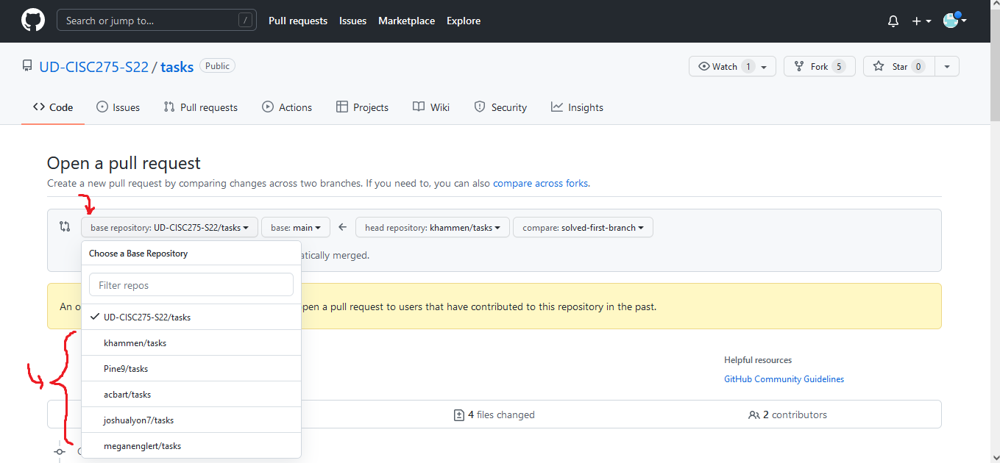

[&laquo; Return to Environment Setup](environment.md)

<details open markdown="block">
  <summary>
    Table of contents
  </summary>
  {: .text-delta }
1. TOC
{:toc}
</details>

Our first task will be to add a little bit of new text to the site. Along the way, we will learn the full workflow for checking your work before you submit it. This is the same workflow you will use for every task from now on.

# Commits

We have previously mentioned that Git organizes projects into repositories, and that a repository is a history of commits. Each commit represents a bunch of changes to some files, with a human-friendly message and a machine-friendly hash attached. The message is written by a person to describe the changes. The hash was created by the machine to uniquely label the commit. These are important for referring to the commits. You can see the latest commits' messages and hashes with `git log`.

<!-- TODO: Get a picture here -->

# Branches

The history of commits is not linear. Instead, it is a graph, because at some points we want to **branch** off changes and work on them separately. The big advantage of this model is that we can work on new features for our application in isolation, without breaking the `main` branch (the special branch that most represents the stable codebase over time). You can branch off branches, and undo branches, and merge branches back into each other. It's a lot to learn all at once.

Would you like some supervised practice with branching? Try this excellent [interactive tutorial](https://learngitbranching.js.org/?locale=en_US)

<!-- TODO: Get a picture here -->

We can use `git checkout` to switch to another branch, replacing the files that we see in the folder based on the commits in that branches history. We also use `git checkout -b` to create a new branch based on the current branch. We can combine changes from another branch with `git merge`.

# Remotes

One last thing to understand is the idea of Remote repositories. Right now, there are a bunch of copies of the same repository out there:

1. There is a local repository on your machine, in a folder
2. There is a remote repository on your Github representing your fork, which we will refer to as `origin`
3. There is the original remote repository on GitHub that you forked, which we will refer to as `upstream`

These three repositories can have a different set of branches and commits, but at any time you could tell them to coordinate with each other and get them back in sync (using `git pull` and `git push`). You won't be able to update our `upstream`, but you will frequently make the `origin` match your local repository.

<!-- TODO: Get a picture here -->

# The Definition of Done

Before we start the task, we need to talk about what it means to be "done".

"It works" is one of the least trustworthy sentences in software. Works on whose machine? With which inputs? Checked how? Professional teams replace the _feeling_ of done with a **Definition of Done**: a written checklist that a piece of work either satisfies or does not.

In this course, our Definition of Done is a short list of commands. A task is not finished until all of them succeed:

1. The TypeScript compiler reports no type errors,
2. `npm run lint` reports no errors or warnings,
3. Every file is formatted with Prettier, and
4. `npm run test:cov` passes every test, with good coverage.

You already met the tests when [setting up your environment](environment.md). Let's meet the others.

## Typechecking

The first step is the **type checker**, which confirms that every value in your program is used in a way consistent with its type. This happens before the program even runs.

You can ask the type checker directly:

```sh
$> npx tsc --noEmit
```

The `npx` command runs a tool from the project's installed dependencies (in this case `tsc`, the TypeScript compiler), and the `--noEmit` flag means "just check the types, do not produce any JavaScript files". No news is good news: if your types are fine, the command prints nothing.

## Linting

A **linter** finds code that is technically legal but likely to be bad: unused variables, conditions that are always true, sneaky types like `any` that turn off typechecking, misused React features. We use the most popular JavaScript/TypeScript linter, ESLint, with a fairly strict configuration:

```sh
$> npm run lint
```

Our configuration treats every warning as an error, because there is no reason for these simple programs to have even warnings.

Pay close attention to this one, because the autograder runs `npm run lint` FIRST - and if linting fails, **your submission's tests are never run at all**. A submission that fails the linter earns no test points, no matter how correct the code is.

## Formatting

Everyone has opinions about how code should be formatted, and most of them do not matter. Nobody should spend their time arguing about indentation, so we let a program called Prettier decide, and then everyone's code looks the same and everyone's changes are easy to read.

The repository you cloned includes settings so that VS Code formats your files with Prettier every time you save — that is why you installed the Prettier plugin during [setup](environment.md). If you ever need to format every file from the terminal, you can also run:

```sh
$> npm run format
```

Formatting is the gentlest check of the bunch, since it fixes your files instead of complaining about them.

## Coverage

The `npm run test:cov` command does more than run the tests. The `cov` stands for **coverage**, which measures which lines of your code were actually executed by at least one test. That is what the big table it prints means, with a row per file and percentages in the columns.

When your work is graded, part of your score comes from coverage: the instructor tests are run against your code, and the resulting coverage must stay above a minimum threshold. Code that never runs during the tests (leftover experiments, half-finished functions, unused helpers) drags your coverage down, so clean up after yourself.

One warning: coverage proves that code was _visited_ by a test, not that the test checked anything meaningful there. Full coverage is a floor, not a goal.

## How Your Work Is Graded

Now that you know all the checks, here is what actually happens when you submit to GradeScope:

1. The autograder finds the `src/` folder in your submission.
2. It **deletes your test files** and copies in the instructor's own version of the tests. (You cannot grade your own homework!)
3. It installs the dependencies and runs `npm run lint`. If linting fails, grading stops here: you get the linter's complaints as feedback, and no test points.
4. It runs the instructor tests against your code, with coverage. Each passing test earns points, and keeping coverage above the threshold earns a few more.

Separately, every time your fork's `main` branch is updated on GitHub, a daemon script ([GitHub Actions](https://github.com/features/actions)) installs, lints, builds, and tests your code from scratch on a clean machine, and then deploys your site. That is what the green checkmark or red X next to your commits means. If a step fails, the later steps are skipped, your site does not update, and clicking the red X shows you which step went wrong.

You should never be surprised by the autograder. Every check it runs is a check you can run yourself, locally, before you push. By the end of this chapter, we will make that so easy that you have no excuse not to.

# 📝 Task - Create Your First Branch

Every time we start a new task, we will have you run the same general set of commands. Here are the commands we want you to run right now:

```sh
$> git pull upstream main
$> git fetch upstream task-first-branch
$> git checkout -b solved-first-branch
$> git merge upstream/task-first-branch
```

First, we are `pull`ing the latest versions of the `main` tasks branch from our upstream. If we have pushed any bug fixes to the main repository files, this will retrieve them.

Next, we `fetch` the latest version of the `task-first-branch`, which has a bunch of instructor-provided code to help us get started on the task. Normally, we would use `pull` since it does a `fetch` and a `merge`, but we are going to do these separately so that we can put the files into a new branch with our solution.

Then, we have you `checkout` a new branch (the `-b` means create a new branch and switch to it) that is named `solved-first-branch`, since this branch will contain our solution to the first task.

Finally, we `merge` in the upstream branch named `task-first-branch` which has those instructor-provided files we mentioned. Remember, at any given time, there are multiple repositories, each potentially with their own version of a given branch. So if you see things like `upstream/task-first-branch`, we're referring to the remote's version of that branch (which might not even have a local version).

Depending on your operating system and command line setup, you may be asked to write a "commit message" when you try to `merge`. You can use the default message.

## The New Test

When we ran `git merge upstream/task-first-branch`, a new file appeared named `src/text.test.tsx`. The file contains a single new test; inspecting its contents will reveal that the test expects the text `"Hello World"` without quotes to be somewhere on the page.

You might want to see the test is failing by first running the command line tests. In Visual Studio Code, bring up a new terminal and enter:

```sh
$> npm run test:cov
```

You can quit by pressing the `q` on your keyboard.

Then, run the site:

```sh
$> npm run start
```

You are now ready to add the text `"Hello World"` somewhere. Up to you to decide, but we would probably suggest the body. Make sure you don't replace the text `"CISC275"` because the original tests will still look for those!

Once you have visually confirmed the text is there, you can use `CTRL+C` to cancel the `npm run start` command running in the terminal. Then, run the tests again:

```sh
$> npm run test:cov
```

If all tests pass, the code is working... but remember our [Definition of Done](#the-definition-of-done): working code is only one item on the checklist.

## Run All the Checks

Run the rest of the checks now:

```sh
$> npx tsc --noEmit
$> npm run lint
$> npm run format
```

For a change this small, they will most likely pass on the first try — but run them anyway. The point is to build the habit while the stakes are low. When a later task has you writing real functions and components, these commands will catch problems that the tests cannot.

## Create the `check` Command

Typing four commands before every single push is going to get old fast. Time to automate.

The `"scripts"` section of the `package.json` file in your repository maps command names to the commands they run . It is the reason `npm run start` and `npm run test:cov` work at all. Scripts can even call other scripts. Open `package.json`, find the `"scripts"` section, and add these two lines:

```json
"typecheck": "tsc --noEmit",
"check": "npm run typecheck && npm run lint && npm run format && npm run test -- --watchAll=false --coverage"
```

The `package.json` file is JSON, which has strict rules about commas: every line in the section must end with a comma except the last one. If `npm` starts complaining that it cannot read the file, check your commas.

The first new script just gives `npx tsc --noEmit` a friendlier name. The second one chains the whole Definition of Done together: the `&&` operator runs commands one after another, stopping at the first failure, so `check` fails fast at the earliest broken check instead of burying the problem under later output. The extra `--` in the test command passes the remaining options through to the test runner, telling it to run once (with coverage) instead of watching forever.

Now run it:

```sh
$> npm run check
```

**From now on, run `npm run check` before every push, on every task.**

Fair warning: on future tasks, `npm run check` will usually fail right after you merge in the instructor's starter code, because the starter files are intentionally incomplete. That is a good thing! The task is done when `check` passes again.

Keep in mind that `package.json` is a file in your repository, so commit this change along with the rest of your work. Once this branch is merged, the `check` command will be there for every task that follows. Do not worry that editing `package.json` might confuse the autograder: it only copies your `src/` and `public/` folders, not your `package.json`, so these scripts are purely for your own benefit.

## Make a Pull Request

Many folks feel that the best way to merge changes from a branch back into the `main` branch is to make a Pull Request on the remote repository. This forces you to show your code to your colleagues, which will be critical to working together in teams later on. Therefore, we are going to follow this model starting from here on, even though we are working alone.

The first time you push your changes for this branch, you will need to run the following command after you have added and committed your files:

```sh
$> git push --set-upstream origin solved-first-branch
```

This makes the local branch `solved-first-branch` available on the remote, and then pushes the branches' commits. You can now return to the repository on GitHub, where you will be presented with an orange box offering to make a Pull Request. This will let you merge the new branch into your `main` branch (thereby deploying your latest changes to the site). Click the button to get started.

The default base repository for your Pull Request is the original repository you forked (which belongs to us). You do not have permissions to make Pull Requests to the repository, nor do you want to. Instead, you will need to choose your own repository from the dropdown. Make sure you do not make a Pull Request to someone else, or you will be a nuisance to them!



Assuming you do not have any issues with your code, you can click through the menus and initiate the Pull Request. Once completed, the `main` branch is updated and should rebuild itself shortly. After a couple minutes, your changes should now be live on the deployed site.

## Submitting on GradeScope

You will need to once again submit on GradeScope. You should be able to submit either your `main` branch (now that it is up to date), or the `solved-first-branch`. The choice is yours, although I suspect the `solved-first-branch` will be simpler (just in case any future edits you make to `main` interfere with the unit tests from this chapter).

Since the autograder runs the same checks you just ran locally, a passing `npm run check` means there should be no surprises in your score. If the autograder does report a problem you did not see locally, read its output carefully but also make sure you try running the commands locally.

Once you're done, we can start our [Basic Application &raquo;](../2-app/index.md)
